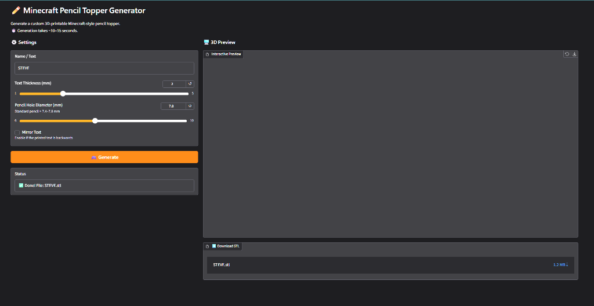
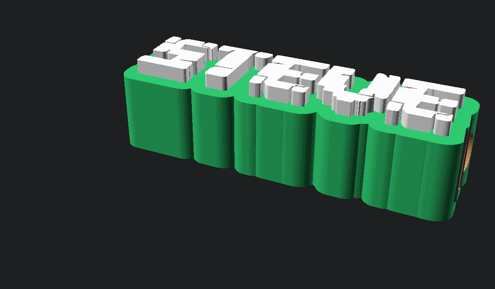
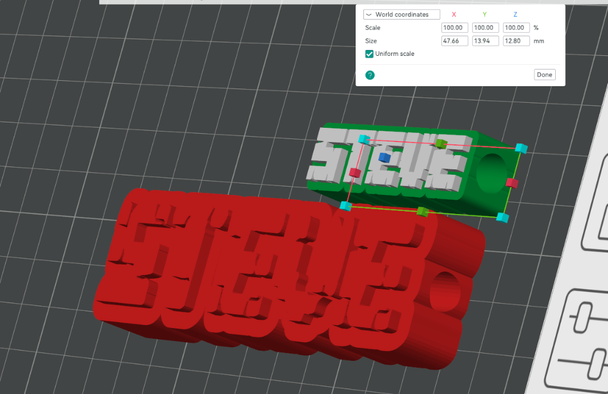

# ✏️ Minecraft 3D Pencil Topper & Keyring Generator
### مولّد قبعات الأقلام والميداليات ثلاثية الأبعاد بنمط ماينكرافت

[](https://www.python.org/)
[](https://gradio.app/)
[](https://openscad.org/)
[](LICENSE)

[-blue?logo=windows&style=for-the-badge)](https://github.com/music-dj/minecraft-pencil-topper-generator/releases/latest)


An interactive parametric web application designed for 3D printing enthusiasts. Generates custom Minecraft-themed pencil toppers and name keyrings with instantaneous color rendering and clean STL file export.

تطبيق ويب تفاعلي لتوليد مجسمات ثلاثية الأبعاد جاهزة للطباعة (قبعات أقلام وميداليات مفاتيح) بنمط خط ماينكرافت الشهير مع ميزة المعاينة الفورية الملونة وتصدير ملفات STL بضغطة زر.

---

## 📸 Screenshots & Previews / لقطات من البرنامج والنماذج

| 🖥️ Web UI (واجهة البرنامج) | 🎮 3D Render (معاينة المجسم) | 🖨️ Slicer Ready (جاهز للسلايسر) |
| :---: | :---: | :---: |
|  |  |  |

---

## 🌟 Key Features (English)

- ⚡ **Ultra-Fast Two-Stage Processing**: Solves the traditional OpenSCAD slow preview problem. Generates a quick 2D OpenCSG rendered snapshot in ~1-2 seconds, then generates the solid CGAL STL mesh in the background.
- 🎨 **Multi-Color 3D Printing Ready**: Optimized for dual-color printing (e.g. Lime Green base plate + White raised lettering). Perfect for filament swap at layer height or AMS / CFS / MMU systems.
- 📐 **Calibrated Pencil Bore**: Pre-calibrated for standard hexagonal and round pencils (7.8 mm default diameter, customizable from 6.0 to 10.0 mm).
- 🔤 **Custom Minecraft Font Included**: Bundled with the authentic `Minecraft Evenings` font, automatically cached in a clean ASCII directory to prevent Windows path encoding issues.
- 🔄 **Mirror Text Support**: Built-in toggle to invert the text horizontally if needed for specific slicing orientations or mold making.
- 🔑 **Bonus Keyring App (`keyring_app.py`)**: Includes a second full application for generating custom keyrings with 20 Google Fonts, customizable ring connectors, and alternating 3D letter heights.

---

## 🚀 Getting Started (English)

### 1. Prerequisites
- **Python 3.10+** (tested on Python 3.11, 3.12, 3.13)
- **OpenSCAD**: Download and install from [OpenSCAD Official Website](https://openscad.org/downloads.html).
  - The script automatically detects OpenSCAD in standard locations or via `PATH`. You can also specify a custom path via the `OPENSCAD_PATH` environment variable.

### 2. Installation
Clone the repository and install the dependencies:
```bash
git clone https://github.com/music-dj/minecraft-pencil-topper-generator.git
cd minecraft-pencil-topper-generator
pip install -r requirements.txt
```

### 3. Running the Apps

#### A. Minecraft Pencil Topper Generator:
```bash
python app.py
```
The browser will automatically open at `http://127.0.0.1:7860`.

#### B. Custom Name Keyring Generator:
```bash
python keyring_app.py
```
This will launch the keyring generator with font downloader and ring placement controls.

---

## ⚙️ Parameters & Dimensions

| Parameter | Default | Range | Description |
|---|---|---|---|
| **Name / Text** | `STEVE` | Any text | Custom name to be extruded |
| **Text Thickness** | `2.0 mm` | `1.0 – 5.0 mm` | Height of the raised letters above base |
| **Pencil Hole Diameter** | `7.8 mm` | `6.0 – 10.0 mm` | Inner cylindrical cut for standard pencils |
| **Mirror Text** | `False` | `True / False` | Flips text horizontally (mirror axis X) |

*Reference dimensions for standard name `STEVE`: X ≈ 47.66 mm, Y ≈ 13.94 mm, Z ≈ 12.80 mm.*

---

## 🇸🇦 الدليل باللغة العربية (Arabic Documentation)

### نبذة عن المشروع
هذا المشروع مخصص لهواة الطباعة ثلاثية الأبعاد (3D Printing). يتيح لك تصميم قبعة قلم (Pencil Topper) تحمل اسمك أو أي كلمة مخصصة بخط لعبة **Minecraft** الشهير. كما يتضمن تطبيقاً ثانياً لتصميم ميداليات المفاتيح (Keyrings).

### أهم المميزات التقنية:
1. **سرعة فائقة في المعاينة (Fast Preview):** تم حل مشكلة بطء OpenSCAD التقليدية عبر توليد صورة معاينة سريعة خلال ثانية واحدة، بينما يتم تجهيز ملف الـ STL للتحميل في الخلفية.
2. **أبعاد قياسية ومدروسة:** تم ضبط أبعاد التصميم (الارتفاع والعرض وسماكة الجدران) لتكون متوافقة مع الأقلام الخشبية العادية (قطر 7.8 مم) دون أن تنكسر أو تكون ضيقة.
3. **جاهز للطباعة بلونين (Two-Color Printing):** مصمم بحيث تكون القاعدة خضراء بارتفاع معين والكتابة بيضاء بارتفاع إضافي (2 مم)، مما يسهل تغيير الفلمنت عند الوصول لارتفاع معين (Filament Change at Layer) أو عبر أنظمة تعدد الألوان مثل Bambu Lab AMS أو Anycubic ACE أو Creality CFS.
4. **دعم قلب النص (Mirror Text):** في حال أردت طباعة المجسم مقلوباً على وجهه على لوح طباعة بنقشة ناعمة أو خشنة (Textured PEI).

### متطلبات التشغيل:
- نظام تشغيل Windows أو Mac أو Linux.
- تثبيت بايثون: [Python 3.10+](https://www.python.org/).
- تثبيت برنامج: [OpenSCAD](https://openscad.org/).

### طريقة التثبيت والتشغيل:
1. قم بتحميل أو استنساخ المشروع:
```bash
git clone https://github.com/music-dj/minecraft-pencil-topper-generator.git
cd minecraft-pencil-topper-generator
```
2. تثبيت المكتبات المطلوبة:
```bash
pip install -r requirements.txt
```
3. تشغيل برنامج قبعة القلم:
```bash
python app.py
```
سيفتح المتصفح تلقائياً بواجهة تحكم بسيطة وأنيقة.

4. لتشغيل برنامج الميداليات:
```bash
python keyring_app.py
```

### مجلد النماذج الجاهزة (`samples/`):
يحتوي مجلد `samples/` على نماذج STL جاهزة للطباعة فوراً مثل:
- `STEVE.stl`
- `ANAS.stl`

---

## 📂 Project Structure / هيكل المشروع

```text
minecraft-pencil-topper-generator/
│
├── app.py                      # Minecraft Pencil Topper Web Application
├── keyring_app.py              # Custom Name Keyring Generator
├── MinecraftEvenings-lgvPd.ttf  # Minecraft style font file
├── requirements.txt            # Python dependencies (gradio)
├── .gitignore                  # Git ignore file
├── README.md                   # Documentation in English & Arabic
├── images/                     # UI Screenshots & rendered previews
│   ├── topper_preview.png
│   ├── web_ui_preview.png
│   └── slicer_preview.png
└── samples/                    # Sample pre-generated STL models
    ├── STEVE.stl
    └── ANAS.stl
```

---

## 📜 License
Distributed under the MIT License. Feel free to use, modify, and distribute.

صنع بحب لهواة ومبدعي الطباعة ثلاثية الأبعاد ❤️